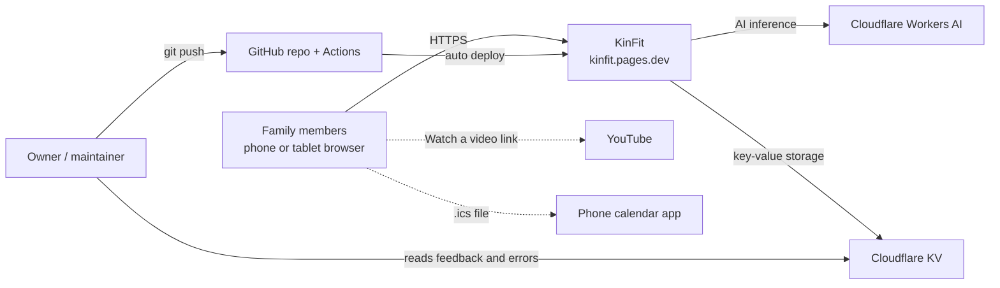
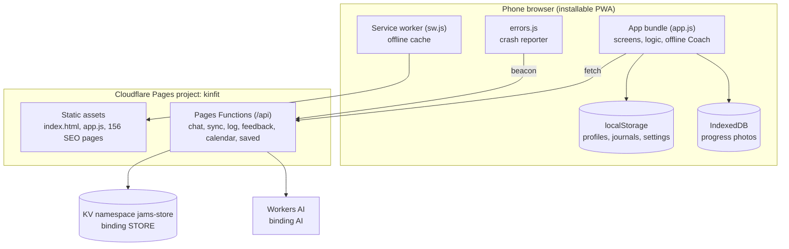
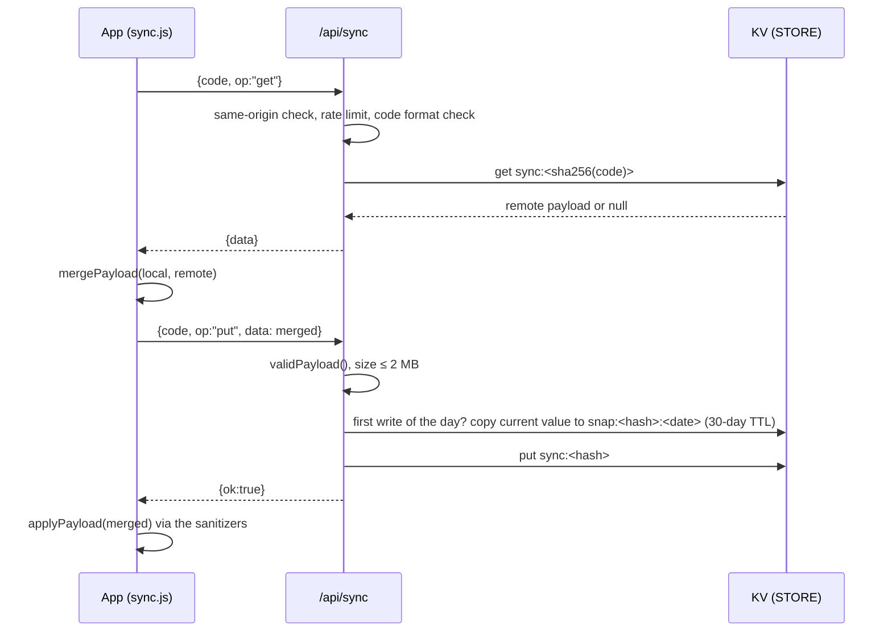
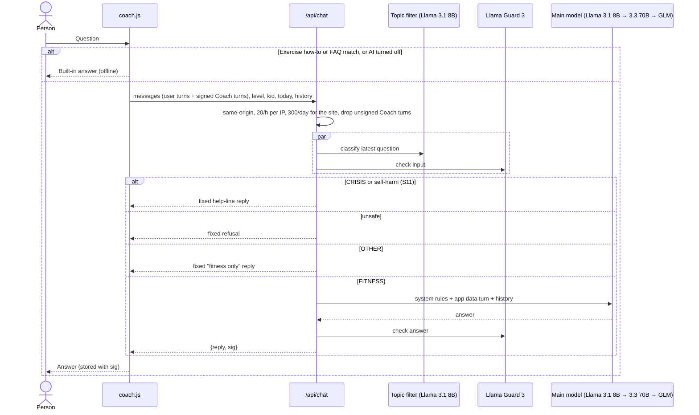
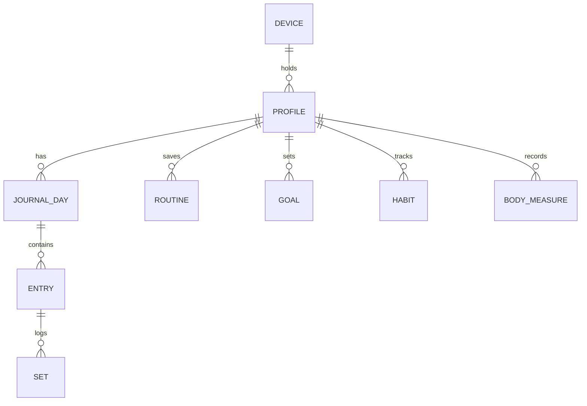

# KinFit: Solution Architecture Document

| | |
|---|---|
| **System** | KinFit family workout web app (https://kinfit.pages.dev) |
| **Repository** | `jagsrj/WorkoutRoutine` |
| **Owner** | Jagadish (JAMS family) |
| **Version** | 1.0 |
| **Date** | 31 October 2026 |
| **Status** | Draft for owner review |
| **Covers** | Code on `main` after PR #30 (Coach guardrails, muscle recovery, 128-exercise library, set types and supersets) |

---

## Contents

1. [Executive summary](#1-executive-summary)
2. [Business context and scope](#2-business-context-and-scope)
3. [Requirements](#3-requirements)
4. [Architecture principles and key decisions](#4-architecture-principles-and-key-decisions)
5. [System design (context and containers)](#5-system-design-context-and-containers)
6. [High-level design (HLD)](#6-high-level-design-hld)
7. [Low-level design (LLD)](#7-low-level-design-lld)
8. [Security and privacy](#8-security-and-privacy)
9. [Performance, scalability and cost](#9-performance-scalability-and-cost)
10. [Operations](#10-operations)
11. [Quality and testing](#11-quality-and-testing)
12. [Risks, limitations and technical debt](#12-risks-limitations-and-technical-debt)
13. [Roadmap options](#13-roadmap-options)
14. [Appendix](#14-appendix)

---

## 1. Executive summary

KinFit is a free, installable web app (PWA) that lets a family plan, follow and track strength workouts on their phones. It supports several people per device, three levels (Beginner, Intermediate and Expert), child profiles with safety limits, and an AI "Coach" that answers fitness-only questions.

The architecture is **client-heavy and serverless**:

- **All product logic runs in the browser.** The app is one JavaScript bundle (`app.js`) built from 14 source files with no framework. Workout data lives on the device (`localStorage`, plus IndexedDB for photos) and works offline through a service worker.
- **Cloudflare Pages** hosts the static files and runs a few **Pages Functions** (`/api/*`) for jobs a phone can't do alone: optional cloud sync and backup, the AI Coach, error and feedback collection, and calendar reminders.
- **Cloudflare KV** stores sync data, daily snapshots, rate-limit counters, feedback and error reports. **Cloudflare Workers AI** runs the Coach (Llama 3.x models), guarded by a topic filter and Llama Guard 3.
- **GitHub Actions** checks every change (build freshness, guardrail unit tests, a Playwright smoke test) before Cloudflare deploys it automatically.

This design gives near-zero running cost, no user accounts, privacy by default and offline use. The main trade-offs are device-bound data unless sync is on, last-write-wins merging, and abuse controls based on IP address because there are no accounts.

---

## 2. Business context and scope

### 2.1 Purpose and goals

| Goal | How the design supports it |
|---|---|
| Feel like a market product while staying free | Static hosting plus serverless functions on free tiers; no paid backend |
| Simple enough for a 12-year-old | Big tap targets, guided workouts, voice coach, plain language, level quiz |
| Safe for children | Child profiles, age caps on levels, kid-safe Coach rules, parent PIN, no "to failure" sets for kids |
| Private by default | No sign-up; data stays on the device; sync is opt-in and keyed by a secret code |
| Works in the gym with bad signal | Offline-first service worker; all logic local |
| Discoverable | 156 generated, search-friendly pages for plans, exercises and guides |

### 2.2 Users and personas

| Persona | Needs |
|---|---|
| **Parent / adult lifter** | Plans by equipment, progression, records, recovery advice, supersets, RPE |
| **Child / teen (12–17)** | Bodyweight plans, safe Coach answers, badges and streaks, no diet advice |
| **Family as a group** | Several profiles on one phone, family challenge, high-fives, shared backup |
| **Owner / maintainer** | Low cost, easy deploys, error reports, feedback inbox |

### 2.3 In scope

The web app, its Cloudflare functions and storage, the generated SEO pages, CI/CD and the AI Coach.

### 2.4 Out of scope (current non-goals)

Native iOS and Android apps, wearables and health-platform integrations, user accounts and social networking outside the family, payments, nutrition and calorie tracking (deliberately excluded for child safety).

---

## 3. Requirements

### 3.1 Functional requirements (summary)

| ID | Capability | Notes |
|---|---|---|
| F1 | Onboarding and level quiz | 5 questions; level capped by age (under 13 → Beginner; 13–17 → no barbell plan without a coach) |
| F2 | Multiple people per device | Up to 20 profiles; each has its own level, history, badges and avatar |
| F3 | Weekly plan and Today screen | Mon Upper A, Tue Lower A, Wed active rest, Thu Upper B, Fri Lower B, Sat bonus, Sun rest |
| F4 | Guided workout | Set logging with a number picker, rest timer with beep, vibration and voice, timed holds, swaps, supersets, set types, RPE |
| F5 | Progression | Double progression; 6-month phases (Foundation, Build, Strength) with a recovery week every 4th week |
| F6 | Exercise library | 128 exercises with steps, tips, an animated figure, a body map, swaps, equipment needs and video links |
| F7 | Equipment profile | "My equipment" rewrites exercises into versions the person can do |
| F8 | Progress | Calendar, streaks, per-exercise charts, PRs and estimated 1RM, muscle map (sets, load, strength, readiness), monthly report |
| F9 | Muscle recovery | Per-muscle fatigue model; Today warns and suggests a fresher workout |
| F10 | Coach chat | Built-in answers offline; AI answers for fitness questions only; builds workouts from the library |
| F11 | Custom workouts and sport plans | User routines, custom exercises, a builder, sport plans (cricket, soccer, swimming, running, basketball) |
| F12 | Engagement | 17 badges, goals, monthly challenges, family leaderboard, habits, share cards |
| F13 | Backup and sync | Recovery code; merges data between devices; 30 days of daily snapshots |
| F14 | Parent controls | PIN lock, Coach AI on/off per person, child profiles |
| F15 | Reminders | Repeating calendar event (.ics) |
| F16 | Feedback and error reporting | In-app feedback; automatic error beacons |

### 3.2 Non-functional requirements

| Category | Requirement | Design response |
|---|---|---|
| Availability | Usable with no network | Service worker cache; local data; built-in Coach answers |
| Performance | Fast first load on mid-range phones | One JS file (about 310 KB uncompressed), inline CSS, SVG drawings instead of video, no framework |
| Privacy | No accounts; minimal data leaves the device | Opt-in sync with a hashed key; error reports carry no personal data; photos never leave the device |
| Safety | Child-appropriate content and advice | Coach guardrails (section 7.8); kid rules in the prompt; UI limits |
| Security | Protect against XSS, injection and abuse | Strict CSP, output escaping, input sanitizers on load, same-origin API checks, rate limits |
| Accessibility | WCAG AA | Contrast checked with axe-core; 40–44 px targets; dialogs announced to screen readers; reduced-motion support |
| Cost | Run on free tiers | Static hosting, KV and Workers AI free allowances, AI usage capped per hour and per day |
| Maintainability | One owner, small changes | Plain JS split by feature; generated files checked in CI; smoke tests |
| Portability | iPhone Safari and Android Chrome | Feature detection (wake lock, vibration, speech, share); iPhone manual checklist (`TESTING.md`) |

---

## 4. Architecture principles and key decisions

### 4.1 Principles

1. **Local-first.** The device is the source of truth; the cloud is an optional backup.
2. **Serverless and static.** No servers to patch; everything is either a static file or a short-lived function.
3. **No accounts.** A secret recovery code replaces sign-up.
4. **Safe by default for children.** Safety rules are enforced in code, not only in prompts or UI copy.
5. **One data source for app and website.** The SEO pages are generated from the same exercise data as the app.
6. **Small, dependency-free code.** No runtime npm packages; the browser's built-in APIs only.

### 4.2 Architecture decision records (summary)

| # | Decision | Alternatives considered | Rationale | Consequences |
|---|---|---|---|---|
| ADR-1 | Plain JavaScript, no framework, joined by a small Node script | React or Vue with Vite | Tiny bundle, no build toolchain to maintain, fast on phones | One global scope; HTML is built from strings, so escaping discipline is needed |
| ADR-2 | `localStorage` as the primary store | IndexedDB everywhere; a cloud database with accounts | Simple and synchronous; data is small (KBs to low MBs) | Size limit of about 5 MB per site; Safari may evict data after weeks without use |
| ADR-3 | Cloudflare Pages and Functions | Netlify, Vercel, Firebase | Free tier, global edge, built-in KV and Workers AI, Git deploys, preview builds | Tied to Cloudflare APIs (KV, AI bindings) |
| ADR-4 | KV for sync | D1 (SQLite), Durable Objects | One document per family suits key-value storage; simple | Eventually consistent; last-write-wins merge done on the client |
| ADR-5 | Recovery code instead of accounts | Email or OAuth login | No personal data, works for kids, no password resets | Losing the code means losing access to the cloud copy |
| ADR-6 | Workers AI (Llama) for the Coach | OpenAI or Anthropic APIs | No API key; free allowance; runs on the same platform | Smaller models need stronger guardrails (ADR-7) |
| ADR-7 | Guardrails in code: topic filter, Llama Guard on input and output, signed history | Prompt-only rules | Prompt-only rules were easy to bypass | 3–4 model calls per question; about 1 s extra latency |
| ADR-8 | Generated SEO pages checked into the repo | Server-side rendering | Static, fast and cacheable; CI verifies freshness | Large diffs whenever exercise data changes |
| ADR-9 | Animated SVG stick figures | Videos or GIFs | Tiny, theme-aware, work offline | Poses are approximate 2D drawings |

---

## 5. System design (context and containers)

### 5.1 System context



### 5.2 Containers



### 5.3 Deployment view

| Element | Where it runs | Configuration |
|---|---|---|
| Static site | Cloudflare edge (Pages) | Project `kinfit`; build command `exit 0`; build output directory `public` |
| Functions | Cloudflare Workers runtime (Pages Functions) | `functions/` folder; bindings `STORE` (KV `jams-store`) and `AI` (Workers AI); optional variables `MODEL` and `CHAT_SECRET` |
| Security headers | Edge | `public/_headers` file |
| CI | GitHub Actions (`ubuntu-latest`, Node 22) | `.github/workflows/test.yml` |
| Preview deploys | Cloudflare Pages | Every branch and PR gets `<branch>.kinfit.pages.dev` |

---

## 6. High-level design (HLD)

### 6.1 Component overview

| Component | Responsibility | Main files |
|---|---|---|
| **Presentation and router** | Tab bar, `go(route)` / `render()`, screen rendering | `js/store.js` (router), `js/screens.js` |
| **Domain data** | Levels, exercises, plans, poses, badges, sport plans, muscle mapping | `js/data.js` |
| **Persistence and sanitizing** | `store` wrapper, profile and journal sanitizers, per-person keys | `js/store.js` |
| **Workout engine** | Starting workouts, sets, timers, swaps, supersets, set types, finishing, PRs | `js/screens.js`, `js/features.js` |
| **Training intelligence** | Double progression, phases, recovery model, workout builder, goals, challenges | `js/extras.js`, `js/recovery.js`, `js/smart.js` |
| **Equipment adaptation** | Rewrites exercises for the person's equipment | `js/gear.js` |
| **Coach (client)** | Built-in FAQ and exercise answers; calls `/api/chat`; builds workouts | `js/coach.js`, `js/smart.js` |
| **Sync (client)** | Recovery code, merge, push and pull, snapshots | `js/sync.js` |
| **Media** | Progress photos in IndexedDB | `js/photos.js` |
| **Engagement** | Habits, badges, family features, share cards, report | `js/habits.js`, `js/extras.js`, `js/features.js` |
| **Settings** | Me screen, parent controls, display, data export | `js/me.js`, `js/more.js` |
| **Edge API** | Six Pages Functions plus shared libraries | `functions/api/*`, `functions/_lib/*` |
| **Offline** | Network-first cache of the app shell | `sw.js` |
| **Build** | Joins the bundle and generates SEO pages | `scripts/build.js`, `scripts/pages.js` |

### 6.2 Key flows

#### 6.2.1 Logging a workout (fully local)

```mermaid
sequenceDiagram
  actor P as Person
  participant UI as Workout screen
  participant LS as localStorage
  P->>UI: Start today's workout
  UI->>LS: jams_active = plan + empty sets (weights pre-filled from last session)
  loop each set
    P->>UI: Enter reps / weight, tap ✓
    UI->>LS: save jams_active
    UI-->>P: Rest timer (shorter after a warm-up, none inside a superset or before a drop set)
  end
  P->>UI: Finish
  UI->>LS: append entries to workout_journal[date]; delete jams_active
  UI-->>P: Celebration, PRs, badges
  UI->>UI: syncNow(silent) if a recovery code exists
```

#### 6.2.2 Backup and sync



#### 6.2.3 Coach question



### 6.3 Technology stack

| Layer | Technology |
|---|---|
| UI | HTML5, inline CSS (light/dark themes and level colours as CSS variables), vanilla ES2020 JavaScript, inline SVG |
| Browser APIs | localStorage, IndexedDB, Service Worker, Web Crypto, Web Speech (speechSynthesis), Vibration, Wake Lock, Web Share, AudioContext |
| Edge | Cloudflare Pages Functions (Workers runtime, ES modules) |
| Data | Cloudflare KV |
| AI | Workers AI: `@cf/meta/llama-3.1-8b-instruct-fast`, `@cf/meta/llama-3.3-70b-instruct-fp8-fast`, `@cf/zai-org/glm-4.7-flash`, `@cf/meta/llama-guard-3-8b` |
| Build and test | Node 22 scripts, Playwright (Chromium), GitHub Actions |

---

## 7. Low-level design (LLD)

### 7.1 Source layout

```
public/               EVERYTHING the website serves (Cloudflare build output directory)
  index.html          App shell: markup, all app CSS, loads js/errors.js then app.js
  app.js              GENERATED bundle (do not edit)
  js/errors.js        Loaded separately and first: global error reporter
  sw.js               Service worker
  _headers            Security headers
  exercises/ plans/ guides/ workouts.html sitemap.xml   GENERATED SEO pages
  about.html privacy.html pages.css icon.svg og.jpg manifest.webmanifest robots.txt
js/                   App source (not published), joined in this order:
  data.js store.js screens.js sync.js coach.js photos.js features.js
  gear.js extras.js smart.js recovery.js habits.js more.js me.js
functions/api/        chat.js sync.js log.js feedback.js calendar.js saved.js
functions/_lib/       limit.js (rate limit, JSON, same-origin), guard.js (Coach guardrails)
scripts/              build.js (bundle + pages → public/), pages.js (SEO page generator)
tests/                smoke.js (Playwright, serves public/), chat-guard.test.mjs (Node)
docs/                 Design documents (this file)
```

### 7.2 Build pipeline

1. `node scripts/build.js` reads `js/<name>.js` in the fixed `ORDER` and joins them under a "GENERATED FILE" header into `public/app.js`. All generated output goes to `public/`.
2. `scripts/pages.js` loads `js/data.js` and `js/gear.js` in a Node `vm` sandbox and renders the hub, level and sport plan pages, one page per exercise and per equipment variant, the home-gym guide and `sitemap.xml`. Slugs come from exercise names; duplicates get a suffix.
3. `--check` mode compares every generated file with what is committed and fails CI if anything is stale or orphaned.

**Load order constraint:** the files share one global scope. Top-level code may only use names defined by earlier files. Functions may reference any name, because they run after the whole bundle has loaded. `me.js` is last because it calls `render()` and registers the service worker.

### 7.3 Runtime: routing and rendering

- `route` and `routeArg` are globals. `go(r, arg)` sets them, records the route for error reports (`self.__r`) and calls `render()`.
- `render()` loads custom exercises, applies the equipment profile (`applyGear()`), sets `body[data-level]` for theming, toggles the tab bar and calls the screen function (`renderToday`, `renderWorkout`, `renderLibrary`, `renderProgress`, `renderAsk`, `renderMe`, `renderOnboard`, `renderReport`).
- Each screen builds an HTML string, assigns `innerHTML` once, then binds handlers with `querySelectorAll('[data-…]')`. Some cards use document-level delegated listeners (`[data-mm]`, `[data-stretch]`).
- Overlays use `sheet(html, onMount)` in `#layer`. Small helpers include `toast()`, `confirmBox()`, `pickNumber()` and `undoable()`.
- **Escaping rule:** every user-controlled string goes through `esc()` before entering HTML. Text stored in profiles is also stripped of `<>"\`` by `cleanText()`.

### 7.4 Client storage

#### 7.4.1 Keys

Keys marked "per person" are suffixed with `_<profileId>`, except for the migrated legacy profile (`pKey()`).

| Key | Scope | Content |
|---|---|---|
| `jams_profiles` | device | `{current, list: Profile[], deleted: string[], legacyId?}` |
| `workout_journal` | per person | `Journal` (see 7.5) |
| `jams_active` | per person | Workout in progress |
| `jams_tomb` | per person | IDs of deleted journal entries (up to 2,000), used by the merge |
| `jams_chat` | per person | Last 40 Coach messages (`{role, content, sig?, build?}`) |
| `jams_intervals` | per person | Interval timer presets |
| `jams_sync` | device | `{code, last}` recovery code and last sync time |
| `jams_pin` | device | SHA-256 of `"jams-pin:" + PIN` |
| `jams_voice`, `jams_theme`, `jams_text`, `jams_bar`, `jams_remind`, `jams_pinasked` | device | UI preferences |
| `jams_ask_times` | device | Timestamps of AI questions (client-side limit of 20 per hour) |
| IndexedDB `jams_photos` | device | Progress photos (never synced or uploaded) |

#### 7.4.2 Sanitizing on load

`sanitizeProfile()` and `sanitizeJournal()` rebuild every object field by field with allow-lists, regexes, length caps and number clamps. They run on every save and when synced data is applied, so corrupted or hostile data (for example from a tampered sync payload) cannot inject markup or break rendering. The smoke test covers this with booby-trapped data.

### 7.5 Data model



**Profile** (selected fields)

| Field | Type | Notes |
|---|---|---|
| `id` | string | `p[a-z0-9]{1,40}` |
| `name`, `avatar` | string | Name up to 24 characters; avatar from a fixed emoji list |
| `level` | enum | `beginner`, `intermediate` or `expert` |
| `kid` | bool | Child profile (kid-safe Coach, no to-failure sets, PIN prompt) |
| `unit` | enum | `lbs` or `kg` |
| `rest` | enum | `auto`, `45`, `60`, `90` or `120` |
| `planStart` | ISO date | Start of the 24-week phase plan |
| `gear` | string[] | `db`, `cable`, `smith`, `smithlp`, `barbell`, `ez`, `bench`, `pullbar`, `machines` |
| `routines` | Routine[] | Up to 50; `items: [exerciseId, sets, repsLow, repsHigh][]` |
| `customEx` | map | Up to 100 custom exercises with `c_` IDs |
| `goals`, `habits`, `hlog`, `body`, `badges`, `chDone`, `fives`, `videos`, `todayHide`, `coachAI` | various | All allow-listed and capped |
| `updated` | epoch ms | Used for last-write-wins on profiles |

**Journal:** `{ "YYYY-MM-DD": Entry[] }`

| Entry field | Type | Notes |
|---|---|---|
| `id` | number or string | Unique per entry (`Date.now()+i`) |
| `exercise` | string | Exercise **name** (not ID; see technical debt) |
| `sets` | Set[] | Up to 30 |
| `unit` | `lbs` or `kg` | Unit at logging time; converted for display |
| `level`, `workout`, `timestamp` | string | Context |
| `effort` | 1, 2 or 3 | "How did that feel?" |
| `ss` | `A`–`H` | Superset group |
| `u` | epoch ms | Last-modified time (merge and recovery timing) |
| `kind`, `act`, `minutes`, `distance`, `dunit` | — | Activities (walks, runs, sports) |

**Set:** `{reps, weight, t?: 'w'|'d'|'f', rpe?: 6..10}`. Warm-up sets (`t:'w'`) are left out of records, progression, muscle stats and recovery (`workSets()`).

**Active workout (`jams_active`):** `{key, level, plan, date, started, title?, emoji?, warm?, items: [{id, sets: [{reps, weight, done, t?, rpe?}], orig?, p?, effort?, link?}]}`. `link:true` joins an item to the next one in a superset.

**Sync payload:** `{v:1, profiles: Profile[], deletedProfiles: string[], data: {<profileId>: {journal, tomb}}}`

### 7.6 Training algorithms

| Algorithm | Logic |
|---|---|
| **Weight pre-fill** | Heaviest working set from the last session of the same exercise, converted to the current unit |
| **Double progression** | If last time every main set reached the top of the rep range, suggest +5 lbs / +2.5 kg (weighted) or +2 reps / +5 s (bodyweight); otherwise show last time's numbers |
| **Phase plan** | Weeks 1–8 Foundation; 9–16 Build (+1 set on the first exercise); 17–24 Strength (weighted reps −2, timed +10 s); every 4th week −1 set (recovery week) |
| **Estimated 1RM** | Epley formula `w × (1 + reps/30)`, reps capped at 12 |
| **PR detection** | Compares the finished entries with the records table from before the workout (heaviest weight, then e1RM, then reps for bodyweight moves) |
| **Recovery model** | For each muscle: fatigue = Σ (working sets × role weight × effort factor × RPE factor × linear decay). Role weight is 1 for the main muscle and 0.5 for helpers. Effort "too hard" ×1.3, "easy" ×0.8; average RPE ≥ 9 ×1.15. Decay over 36–72 h depending on the muscle. Activities add load per 10 minutes. Readiness = 1 − fatigue/10. Below 0.4 = tired; 0.7 and above = ready |
| **Today recovery card** | Shown if any main muscle of today's plan is below 0.4; suggests the other workout with the highest minimum readiness (at least 0.7), or stretching |
| **Workout builder** | Filters by equipment (`none`, `dumbbells`, `gym`) and level (barbell lifts for Expert only); prefers rested muscles when at least 2× enough candidates remain; round-robin across muscle groups; sets and reps by level |
| **Equipment adaptation** | `GEAR_REQ` (from the `need` field or explicit lists). If the person lacks the gear, try `GEAR_VARIANTS` in order (own steps, or `use` another exercise); otherwise mark "needs …" so the person can swap |

### 7.7 API specification (Pages Functions)

Shared behaviour (`functions/_lib/limit.js`):

- `sameOrigin()`: rejects requests whose `Origin` header names another host (requests with no `Origin` are allowed).
- `overLimit(env, key, max, ttl)`: a fixed-window counter in KV (`rl:<key>`), with an in-memory fallback if KV isn't bound.
- `json()`: JSON response with `cache-control: no-store`.

| Endpoint | Method | Request | Response | Limits and storage |
|---|---|---|---|---|
| `/api/chat` | POST | `{messages[], level, kid, today?, history?}` or `{mode:'build', request, catalog, level, kid}` | `{reply, sig?}` / `{reply, guarded:true}` / `{plan}` / `{error}` 400/403/429/502/503 | 20 per hour per IP and 300 per day for the site; up to 8 history turns of at most 600 characters each |
| `/api/sync` | POST | `{code, op}`; op is `get`, `put` (+`data`), `delete`, `snapshots` or `snapshot` (+`date`) | `{data}` / `{ok}` / `{dates}` / `{error}` | 60 per hour per IP; body up to 2 MB; code `XXXX-XXXX-XXXX-XXXX` from a 31-character alphabet |
| `/api/log` | POST | `{m, s, l, r, v, d}` (message, file, line, route, version, device type) | 204, 400 or 429 | 30 per hour per IP; KV `err:<date>:<id>`, kept 30 days |
| `/api/feedback` | POST | `{kind, text, …}` | `{ok}` or error | 5 per hour per IP; KV `fb:<date>:<id>`, kept 180 days |
| `/api/calendar` | GET | `?days=MO,TU,…&t=HHMM&name=` | `text/calendar` repeating event with an alert | Nothing stored |
| `/api/saved` | POST | Form post | Redirect back to the app | Lets iPhones offer "Save password" for the recovery code; nothing stored |

**KV key space**

| Prefix | Owner | Value | TTL |
|---|---|---|---|
| `sync:<sha256>` | sync | Latest family payload (metadata `updated`) | none |
| `snap:<sha256>:<date>` | sync | Copy taken before the day's first write | 30 days |
| `rl:<endpoint>:<ip>:<hour>` / `rl:chatday:<date>` | all | Counter | about 1 hour / about 1 day |
| `chat:hmac` | chat | Generated HMAC secret (if `CHAT_SECRET` isn't set) | none |
| `err:<date>:<id>` | log | Error report | 30 days |
| `fb:<date>:<id>` | feedback | Feedback | 180 days |

### 7.8 Coach guardrail pipeline (detail)

| Stage | Implementation | Fails toward |
|---|---|---|
| 1. Client gate | Built-in FAQ and exercise answers first; AI off per person (`coachAI:false`); client limit of 20 per hour | Built-in answer |
| 2. Request hygiene | Same-origin; rate limits; strip control characters; cap history at 8 turns and 600 characters | 4xx |
| 3. History integrity | Coach replies are HMAC-SHA256 signed (`sig`); unsigned or forged assistant turns are dropped; consecutive user turns are merged | Turn dropped |
| 4. Topic filter | `llama-3.1-8b-instruct-fast`, temperature 0, labels FITNESS, OTHER or CRISIS from the latest question plus up to 2 earlier user questions | Fixed reply |
| 5. Input safety | Llama Guard 3 on the latest question; S11 (self-harm) → help-line reply | Fixed reply |
| 6. Prompt design | System rules (kid-friendly, no diet, calorie or supplement advice, no diagnosis, crisis guidance, anti-jailbreak line); app data in a separate user turn marked as data | — |
| 7. Generation | Model fallback chain; max 400 tokens; temperature 0.4 | Next model |
| 8. Output safety | Llama Guard 3 on question + answer | Fixed reply |
| 9. Failure | Any guard error → 502 → the client shows its built-in answer | Closed |
| Build mode | Returns JSON only; the client keeps only exercise IDs from the allowed catalog and clamps sets and reps | Built-in builder |

Fixed replies: off-topic (with example questions), crisis (988, Kids Help Phone 1-800-668-6868 or text CONNECT to 686868, 911), unsafe refusal.

### 7.9 Sync merge algorithm (`mergePayload`)

1. `deletedProfiles` = union of both sides; deleted profiles are removed.
2. Profiles: newest `updated` wins. Habit logs merge day by day (newest `u` per day wins).
3. For each profile: tombstones = union (latest 2,000). For each date, entries from both sides are combined by `id`; tombstoned IDs are dropped; newest `u` wins; sorted by `id`.
4. The merged result is written to KV and applied locally through the sanitizers.

This is a document-level last-write-wins model with per-entry granularity. Concurrent edits of the *same* entry on two devices keep only the newer edit.

### 7.10 Offline strategy (`sw.js`)

- Install: cache the app shell (`./`, `js/errors.js`, `app.js`, `icon.svg`, `manifest.webmanifest`) under `CACHE = 'jams-vNN'`.
- Fetch: **network-first** for app files (updates show at once), falling back to the cache when offline. `/api/` is never cached.
- Activate: delete old caches and claim clients. Bump `CACHE` when adding or renaming shell files.

### 7.11 Observability

| Signal | Source | Where to look |
|---|---|---|
| Client crashes | `js/errors.js` → `/api/log` (at most 5 per page; no personal data) | KV keys `err:*`; Functions real-time logs |
| User feedback | Me → Send feedback | KV keys `fb:*` |
| Traffic | Cloudflare Web Analytics (allowed by the CSP) | Cloudflare dashboard |
| AI usage | Workers AI dashboard; `rl:chatday:*` counters | Cloudflare dashboard / KV |

### 7.12 Configuration

| Name | Type | Required | Purpose |
|---|---|---|---|
| `STORE` | KV binding | For sync, shared limits, logs, feedback | Namespace `jams-store` |
| `AI` | Workers AI binding | For AI Coach answers | Without it the Coach uses built-in answers only |
| `MODEL` | Variable | No | A Workers AI model to try first |
| `CHAT_SECRET` | Secret | No | HMAC key for signing Coach replies (otherwise one is generated and stored in KV) |
| `APP_VERSION` | Constant in `js/errors.js` | — | Tags error reports |

---

## 8. Security and privacy

### 8.1 Controls

| Area | Control |
|---|---|
| Transport | HTTPS only; HSTS for one year |
| XSS | CSP `default-src 'self'` with no inline scripts; `esc()` on all user-supplied text; `cleanText()` strips `<>"\``; sanitizers on load; smoke test with malicious data |
| Clickjacking | `frame-ancestors 'none'`, `X-Frame-Options: DENY` |
| Browser features | `Permissions-Policy` disables geolocation, microphone, camera (photos use a file input), payment and USB |
| API abuse | Same-origin check, per-IP and global rate limits, payload size caps, strict structural validation (`validPayload`) |
| Sync confidentiality | About 79 bits of randomness in the code (16 characters from 31 symbols); KV key is a SHA-256 of a salted code; the plaintext code is never stored on the server |
| Parent PIN | Stored as a salted SHA-256; unlocks for 5 minutes. A device-level convenience lock, not strong security |
| AI safety | See 7.8; kid-specific rules; no diet or weight-loss advice for anyone |
| Secrets | None in the repo; bindings and secrets live in Cloudflare settings |
| Photos | Off by default; IndexedDB only; never uploaded |

### 8.2 Data inventory and privacy

| Data | Location | Leaves the device? |
|---|---|---|
| Profiles, workouts, habits, goals, body measurements | localStorage | Only with sync on (to KV, under a hashed key) |
| Progress photos | IndexedDB | Never |
| Coach questions | Sent to `/api/chat` with level, child flag, today's workout and a short training summary | Processed by Workers AI; not stored by KinFit |
| Error reports | KV, 30 days | Message, file, line, screen, version and device type only |
| Feedback | KV, 180 days | Whatever the user types |

### 8.3 Threat model (summary)

| Threat | Likelihood | Impact | Mitigation | Residual risk |
|---|---|---|---|---|
| Guessing another family's sync code | Very low | High | 79-bit code; 60 requests per hour per IP | Low |
| Stolen recovery code (shoulder-surfing, screenshot) | Low | High | Code saved to the password manager; delete option | Medium: there's no way to rotate the code yet |
| Coach jailbreak or off-topic use | Medium | Medium | Topic filter, Llama Guard, signed history | Low to medium (model-based filters aren't perfect) |
| AI cost abuse | Medium | Low | 20/h per IP, 300/day for the site | Low; distributed IPs could use up the daily cap (denial of service for the Coach only) |
| Malicious sync payload (XSS) | Low | High | Server validation plus client sanitizers and escaping | Low |
| KV write exhaustion | Low | Medium | Rate limits; snapshots once per day | Low |
| Public repo exposes implementation details | — | Low | No secrets in the repo | See section 12 |

---

## 9. Performance, scalability and cost

- **Client:** one roughly 310 KB script plus inline CSS, compressed by the CDN. All screens render from memory; heavy computations (records, recovery) scan at most a few thousand entries.
- **Edge:** functions are stateless and scale automatically. KV reads are served from the edge; writes are eventually consistent, typically visible within about a minute globally. That suits this backup-style use.
- **Hot paths:** `/api/chat` (3–4 model calls) and `/api/sync` (2 calls per sync, plus 1 snapshot write per day).
- **Cost drivers:** Workers AI usage, which is capped by the daily limit, and KV writes (syncs and rate-limit counters). Static hosting and Functions requests fit comfortably in free tiers at family and small-community scale. *Check Cloudflare's current free-tier limits before any public launch; they change.*
- **Scaling to a public product:** the first bottlenecks would be KV-backed rate-limit counters (one write per request), the global AI cap, and `localStorage` size for very long histories. See the roadmap.

---

## 10. Operations

### 10.1 Deploy

1. Branch → commit → push → open a PR.
2. CI runs `build --check`, `chat-guard.test.mjs` and `smoke.js`; Cloudflare builds a preview.
3. Merge to `main` → Cloudflare deploys to production (about 1–2 minutes).

### 10.2 Rollback

Cloudflare dashboard → Pages → `kinfit` → Deployments → pick the previous production deployment → **Rollback**. You can also `git revert` the merge commit and push.

### 10.3 Runbook

| Symptom | Check | Fix |
|---|---|---|
| Coach only gives built-in answers | `AI` binding present? 502 `ai_failed` in Functions logs? Model retired? | Re-add the binding; set `MODEL`; update the `MODELS` list |
| "Sync isn't switched on" | `STORE` binding | Bind KV `jams-store` and redeploy |
| Spike of `err:` keys | Read the reports (route, version) | Fix and redeploy; bump `APP_VERSION` |
| User lost data | They have a recovery code? | Restore from sync, or from a snapshot (Me → Backup → history) |
| Old app still showing | Service worker | It's network-first, so a reload is enough; bump `CACHE` if shell files changed |

---

## 11. Quality and testing

| Layer | Tool | Coverage |
|---|---|---|
| Generated files | `node scripts/build.js --check` | `app.js` and all 156 pages match the source |
| Coach guardrails | `node tests/chat-guard.test.mjs` (fake Workers AI) | Off-topic, crisis, unsafe input and output, forged history, prompt-data isolation, fail-closed |
| End-to-end | `node tests/smoke.js` (Playwright, 390×844 viewport) | Onboarding, quiz, tour, sync merge unit tests, sanitizers, phases, workout flow, effort, PRs, muscle map, activities, custom workouts, Coach, set types, supersets, recovery model, library integrity, XSS hardening, no JS errors |
| Manual | `TESTING.md` | 10-minute iPhone and Safari checklist (audio, share sheet, password save, offline) |
| Accessibility | axe-core | WCAG AA contrast on every screen |

---

## 12. Risks, limitations and technical debt

| # | Item | Impact | Suggested action |
|---|---|---|---|
| T1 | Journal entries reference exercises by **name** | Renaming an exercise splits its history | Store `exId` alongside the name; migrate |
| T2 | One global scope, HTML built from strings | Name clashes; escaping relies on discipline | Move to ES modules; add a lint rule for unescaped interpolation |
| T3 | Last-write-wins sync | Concurrent edits of the same entry lose one side | Field-level merge, or move to D1 with per-entry rows |
| T4 | Device storage limits and Safari eviction | Data loss without sync | Turn sync on by default (already prompted); offer export |
| T5 | No way to rotate the recovery code | A leaked code can't be revoked | Add "change my code" (copy data to a new key, delete the old) |
| T6 | Rate limits keyed by IP | Shared IPs (schools) hit limits; attackers can rotate IPs | Turnstile on the Coach; per-code limits |
| T7 | KV counters for rate limiting | One write per request; not atomic | Use Cloudflare Rate Limiting rules or Durable Objects |
| T8 | ~~Whole repo is the deployed site~~ | Fixed: only `public/` is published | Done (PR moving the site into `public/`) |
| T9 | Model-based guardrails | False positives and negatives | Log guarded outcomes (counts only); review monthly; tune prompts |
| T10 | Videos are YouTube searches | Off-site, variable quality | Curate verified video IDs per exercise |
| T11 | Recovery model is a heuristic | Not medically validated | Keep wording advisory; let users adjust |
| T12 | No automated test for the service worker or iOS | Regressions possible on iPhone | Add WebKit to the Playwright run |

---

## 13. Roadmap options

| Horizon | Item |
|---|---|
| Near term | `exId` in journal entries (T1); code rotation (T5); WebKit in CI (T12) |
| Medium | Optional accounts (passkeys) with D1 storage; CSV export; Health Connect and Apple Health via a native wrapper; French localisation |
| Longer | Curated in-app demo videos; proven programmes (5/3/1, GZCLP); coach-to-athlete sharing for teams and schools |

---

## 14. Appendix

### 14.1 Glossary

| Term | Meaning |
|---|---|
| PWA | Progressive Web App: a website you can install that works offline |
| KV | Cloudflare Workers KV, a global key-value store |
| RPE | Rate of Perceived Exertion; KinFit records it as "reps left in the tank" (10 = none left) |
| 1RM / e1RM | One-rep max / estimated one-rep max |
| Double progression | Add reps until the top of the range, then add weight |
| Superset | Two or more exercises done back to back, then rest |
| Tombstone | A record of a deleted entry's ID so the sync merge doesn't bring it back |
| HMAC | Keyed hash used to sign Coach replies |

### 14.2 Change history

| Version | Date | Change |
|---|---|---|
| 1.0 | 2026-10-31 | First version, covering the code as of PR #30 |
| 1.1 | 2026-10-31 | Site moved into `public/`; backup reminder on the workout-done screen |
